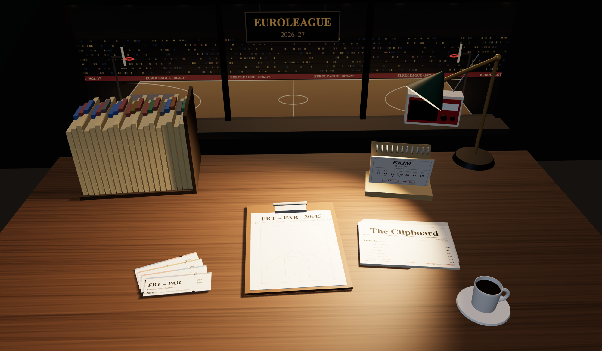
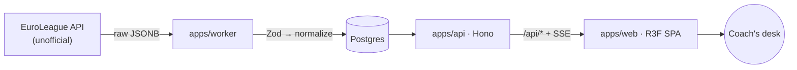
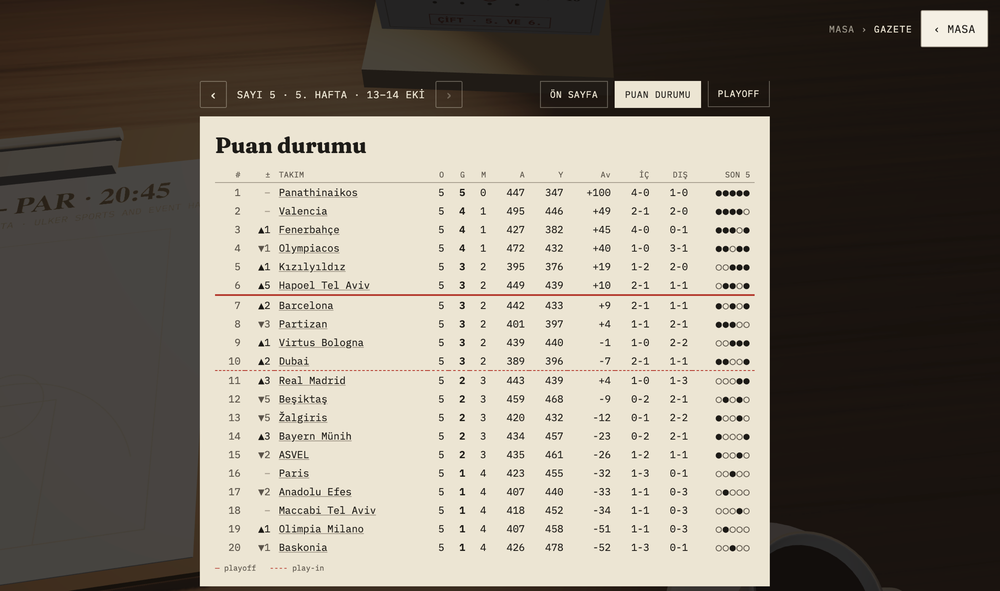
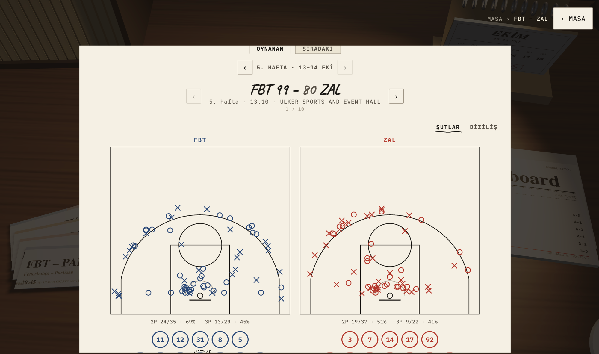

# Clipboard

**A EuroLeague basketball companion that lives on a coach's desk.**

Instead of tables and dashboards, Clipboard renders the season as a 3D coach's room: a desk where every object *is* the data. The folded newspaper is the standings, a ticket is a game, the agenda is the fixture list, and the clipboard on the table is the tactic board. You move from the whole league down to a single player by zooming — desk → document → game → player.

🔗 **Live:** [clipboard.vibedevs.cc](https://clipboard.vibedevs.cc)

> Personal project · built and maintained solo · source code is in a private repository.

<!-- Replace with a real capture — see assets/README.md -->


---

## The idea

Most sports apps are grids of numbers. Clipboard asks a different question: *what if the data looked like a coach's desk the night before a game?*

- **Objects are data.** Nothing is a generic chart. The standings are a newspaper you unfold; a fixture is a ticket you pull from a fan; the tactic board is the coach's own clipboard. Each object has one home, so there's never ambiguity about where a piece of information lives.
- **Semantic zoom instead of navigation.** There are no menus to speak of. You lean into an object and the camera moves with you; the object opens into real content, then into a game, then into a single player's line. Backing out reverses the same path.
- **A signature scene: the tactic board.** Finished games get a connected shot chart and a scout card; live games update the board in near real time.

## Design constraints (on purpose)

- **No AI, no paid services.** Every derived stat — form, clutch, matchup twins, scenario math — is computed with SQL, statistics, and plain rules. Nothing is hallucinated and nothing costs per request.
- **No logos, no player photos.** Teams are rendered as muted "ink on paper" colours with official abbreviations; players as chips with jersey numbers. The identity is typographic, not trademarked.
- **Bilingual from day one (TR / EN).** Every string is a translation key; dates and numbers go through `Intl`.
- **Motion stays cheap.** Animations only touch `transform` and `opacity`, targeting 60 fps on a mid-range phone.

## How it's built

A small TypeScript monorepo, strict everywhere.

```
apps/web        React + Vite SPA — the 3D desk (react-three-fiber) with HTML content layered on top
apps/api        Hono — /api/* endpoints, serves the web build, SSE for live updates
apps/worker     Always-on Node service — polls the EuroLeague API on its own schedule
packages/shared Zod schemas, types, season / club / position constants
```

A few decisions I'm happy with:

- **Raw first, then validated.** Every EuroLeague response is stored verbatim as JSONB *before* anything parses it. Normalized tables (`games`, `teams`, `players`, `shots`, `plays`, `box_scores`, `standings`) are derived from that raw layer. When the (unofficial, undocumented) API changes, or a new derived idea comes up, it's reprocessed from raw — no re-fetching, no lost history.
- **Flexible schemas, loud anomalies.** Zod schemas are permissive (one malformed record shouldn't drop a whole season fetch). Instead, a post-normalize anomaly counter feeds `/api/health`, which flips to `degraded` when something looks off.
- **A worker that changes gear.** Calm mode pulls fixtures and standings hourly; it tightens 30 minutes before tip-off; in live mode it fetches box score, play-by-play and points every 15–30 s with exponential backoff on 429/5xx; on the final whistle it takes one last full snapshot and computes the derived data.
- **One address, no CORS.** Web and API ship from a single service at `clipboard.<domain>`; `/api/*` is the API, everything else is the SPA. Live SSE stays alive through Cloudflare's ~100 s idle cut with a heartbeat every 15–20 s.

### Architecture



## Tech

| Area | Choices |
|------|---------|
| Language | TypeScript (strict), pnpm workspaces |
| Web | React 19, Vite, react-three-fiber 9 + drei 10, TanStack Query, react-i18next |
| Backend | Hono, Drizzle ORM, Zod, pino |
| Data | PostgreSQL 16, raw-response layer + normalized tables |
| Quality | Vitest (tests run against recorded real API fixtures), Biome |
| Infra | Hetzner + Coolify, Cloudflare DNS / proxy / cache |

## Status

The product is live and feature-complete in its first full form: the desk holds the newspaper (standings), tickets (games), agenda (fixtures), tactic board (finished + live), folders, and a few atmosphere objects. Current work is on 3D lighting and materials, phone layout, and polish.

## Screenshots

<!-- Drop the files listed in assets/README.md next to this README, then these will render. -->

| Desk | Newspaper (standings) | Tactic board |
|------|----------------------|--------------|
|  |  |  |

---

<sub>Clipboard is a personal project and is not affiliated with or endorsed by EuroLeague Basketball. Data comes from EuroLeague's public endpoints and is used for a non-commercial, personal application.</sub>
